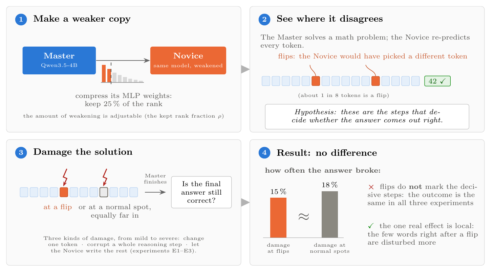
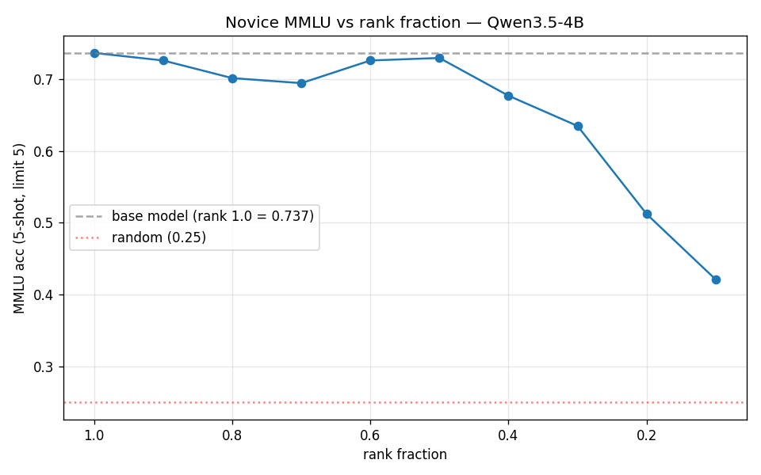
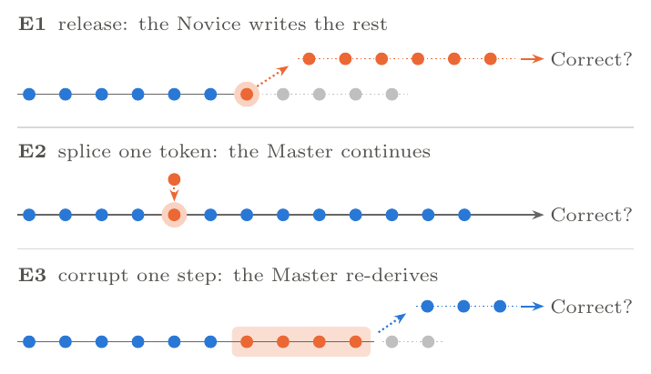
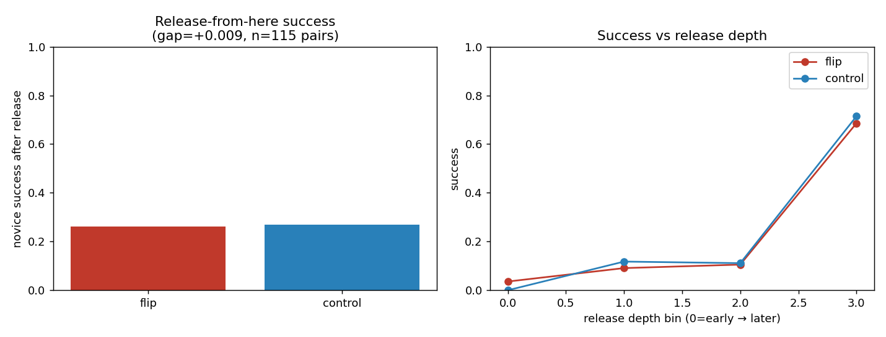

# Does a Weaker Twin Know Where an LLM's Reasoning Matters?

**An interventional test of Master/Novice divergence for reward densification**

Ana Carolina Ramos Cunha, Leonhard Driesch, Leonard Evers

[Full write-up (PDF)](paper/main.pdf) · [Novice checkpoint on Hugging Face](https://huggingface.co/leodriesch/novice-qwen3.5-4b-rf0.1)

---

**TL;DR.** We build a weaker copy of an LLM (the *Novice*) by compressing its MLP
weights, and ask whether the tokens where the Novice disagrees with the full model (the
*Master*) are the tokens that decide whether a math solution comes out right. If they
were, disagreement would be a free, training-free source of dense rewards for RL. Three
intervention experiments on Qwen3.5-4B and MATH-500 say they are not: disagreement
positions carry no more outcome leverage than matched positions where the two models
agree. They are, however, locally fragile: perturbing them disturbs the next few tokens
more, even after controlling for the Master's entropy.



## The problem: one reward for a thousand tokens

Reinforcement learning with verifiable rewards (RLVR) trains a model on tasks whose
final answer can be checked automatically, such as math problems. The reward is sparse:
a solution of several hundred tokens receives a single bit at the end. The policy then
has to work out which of those tokens earned the reward, and most of them did not. A
solution spends many tokens on routine algebra and formatting, and only a few on the
choices that decide the outcome.

Existing ways to densify that signal either rely on task structure (partial test-case
success in code, as in [VeRPO](https://arxiv.org/abs/2601.03525)) or learn a dense
reward model from outcome labels (as in [PRIME](https://arxiv.org/abs/2502.01456)).
Both need something extra: a task with measurable partial success, or a second model to
train.

## The idea: let a weaker copy point at the hard steps

Suppose we had a copy of the policy that is the same model, only weaker. On a correct
solution produced by the strong model, most tokens are easy, and the weak copy would
predict them too. At the hard steps, the weak copy would predict something else. If
those disagreements line up with the steps that matter, we could weight the RL update
toward them, at no training cost.

This is close in spirit to two recent findings. [Wang et al.
(2025)](https://arxiv.org/abs/2506.01939) show that a minority of high-entropy "forking"
tokens carries most of the useful learning signal in RLVR. [TIP](https://arxiv.org/abs/2604.14084)
shows that teacher–student divergence picks out the informative tokens in on-policy
distillation. Whether divergence also picks out the tokens that decide the *outcome* is
a separate question, and the one this project tests.

We make the premise explicit before building anything on it:

> **H1 (outcome leverage).** Positions where the Novice diverges from the Master have a
> larger effect on final-answer correctness than depth-matched positions where the two
> agree.

If H1 holds, divergence-weighted credit is worth building into an RL objective. If it
fails, an RL run would not show anything useful, so we test H1 directly with
interventions instead of training.

## Building the Novice

The Novice has to be weaker in a controlled way. It should keep as much of the Master's
behavior as a given capacity budget allows, so that its disagreements reflect missing
capacity rather than a careless compression.

We compress only the decoder MLPs, using *weight matrix disentanglement* (WMD), which
adapts [tensor disentanglement](https://arxiv.org/abs/2508.19409) to neural network
layers. Each MLP weight matrix is reshaped into a 4th-order tensor and re-split along a
different pair of axes, which exposes structure that a flat SVD misses. Before the
split, a learned orthogonal matrix *Q* (the *gauge*) rotates the row space so that as
much of the spectrum as possible sits in the leading singular directions. Truncating to
rank *k* and inverting the reshape gives the Novice weight. With *Q = I* this reduces to
plain truncated SVD, so the learned gauge can only do better.

One knob controls the Novice's strength: the **rank fraction ρ**, the share of singular
directions each layer keeps. Because the stored factors keep the full decomposition, one
disentanglement run yields a Novice at every ρ by re-truncation.

The `NoviceModel` class in [`src/novice_model.py`](src/novice_model.py) wraps this
lifecycle: load a Hugging Face causal LM, swap every MLP linear for a factored version,
optimize the gauges, save the factors sharded per layer, then *bake* dense weights at
any ρ and generate as usual. Our implementation speeds up the reference optimizer by
roughly 30–50× per layer (Adam on a Cayley-parameterized *Q*, SVD reuse, fp32) and
processes layers in parallel, which made a 4B-parameter model practical. A Novice baked
at ρ = 1 reproduces the base model's logits.

## How weak is the Novice?

On MMLU, accuracy stays near the base model's 0.737 down to ρ ≈ 0.5, then falls to 0.42
at ρ = 0.1.



MMLU scores how the model ranks answer options, not whether it can write. Free-running
generation shows a sharper boundary, which we call the **coherence cliff**. At ρ = 0.1
every generation we inspected collapses into repetition. At ρ ≥ 0.25 the Novice writes
fluent, structured solutions. The disagreement rate tells the same story: when the
Novice re-predicts the Master's tokens, it disagrees on 44% of them at ρ = 0.1 (noise)
and on 12.3% at ρ = 0.25 (concentrated disagreement).

All experiments therefore use **ρ = 0.25**, the weakest Novice that is still coherent.
It is clearly weaker than the Master: handed the Master's own correct solutions partway
through, it finishes them correctly only 26% of the time.

## Three ways to test H1

**Setup.** The Master is Qwen3.5-4B. It solves 23 of the first 50 MATH-500 problems
with greedy decoding. On each correct solution, the Novice re-predicts every token
given the Master's prefix. A **flip** is a position where the Novice's top token differs
from the Master's (10,895 tokens scored, 12.3% flips).

Every experiment compares flips against **depth-matched controls**: non-flip positions
at the same relative location in the solution. Depth matters a lot, because damage late
in a solution is easier to survive, so without matching the comparison would mostly
measure position.



- **E1, release.** At a flip or control position, the Novice takes over and writes the
  rest of the solution. We release at each solution's 5 most confident flips, the ones
  most likely to matter if H1 is true (115 pairs).
- **E2, splice one token.** Replace a single token and let the Master continue. One arm
  inserts the Novice's token at a flip. Two more insert the Master's own second choice,
  at the flip and at its control. This separates the effect of the *position* from the
  effect of the Novice's *specific* token (345 trials).
- **E3, corrupt a step.** Replace a whole reasoning step (a newline-delimited span) and
  let the Master re-derive the answer. Steps with the highest share of flips are
  compared against depth-matched steps with few flips (207 trials).

## Results: no outcome effect

| Experiment | At flips | At matched controls | Test |
| --- | --- | --- | --- |
| E1: Novice finishes correctly | 30/115 (26.1%) | 31/115 (27.0%) | McNemar *p* = 1.00 |
| E2: Master's answer breaks | 3/30 (10.0%) | 6/31 (19.4%) | Fisher *p* = 0.47 |
| E3: Master's answer breaks | 8/53 (15.1%) | 9/51 (17.6%) | Fisher *p* = 0.80 |

None of the comparisons comes close to significance, and in E2 and E3 the difference
points the wrong way for H1.

**E1.** In 108 of 115 pairs, releasing at the flip and at its control gave the same
outcome. The seven pairs that differ split 4 to 3. Success depends on how far into the
solution the handoff happens, rising from near 0 in the earliest quartile to about 0.7
in the latest, and both curves rise together.



**E2.** Here the one real effect appears. A spliced token at a flip disrupts the
Master's next 8 tokens much more than at a control (2.55 vs. 1.60 nats per token).
Flips sit where the Master is less certain, and entropy explains part of the gap, but
not all of it: at equal entropy, a flip still adds 0.62 nats per token (*t* = 2.35).
The disruption never reaches the answer, though. The drop in the answer tokens'
log-probability is about 0.001 nats per token in every arm. The Novice's specific token
also does no more damage than the Master's own second choice.

**E3.** Corrupting an entire reasoning step leaves the final answer intact 84% of the
time, regardless of how many flips the step contains. Replacing a flip-dense step with
the Novice's version of it does no more harm than generic corruption (7/46 vs. 8/53).

## What this means

Disagreement between a model and its weakened copy marks steps that are **hard for the
weaker model to produce**. That is a different property from being **critical to the
outcome**, and the two do not line up here. Much of what the extra MLP capacity buys
appears to be fluency and confidence at delicate positions, which is exactly what the
local-disruption effect picks up. The content that decides the answer is either spread
across the solution (the Master re-derives it after corruption) or concentrated in a
few steps that flips do not single out.

The same signal can still be useful in distillation, where "hard for the weaker model"
is itself the training target. For RL credit assignment, outcome leverage has to be
shown separately, and these experiments show how to check it before spending compute on
training runs.

Three directions remain open:

1. Use divergence in aggregate, for example total divergence per solution as a
   difficulty signal, rather than per token.
2. Combine divergence with entropy-based token selection, since each carries
   independent local information.
3. Test graded divergence measures (KL or Jensen–Shannon) instead of top-1 flips. H1 is
   untested for them, not refuted.

**Limitations.** One Master (Qwen3.5-4B), one Novice family (MLP-only, gauge optimized
at ρ = 0.1 and baked at 0.25), one dataset with 23 solved problems that skew easy,
greedy decoding, and top-1 flips. The binary outcome tests can rule out large effects
but not modest ones: E1 would detect a gap of about 11 percentage points with 80% power.
The gauge optimization stopped after 40 steps with the loss still falling. The
[write-up](paper/main.pdf) covers these in detail, along with power calculations and
all hyperparameters.

## Reproducing the results

The project uses [uv](https://docs.astral.sh/uv/) and Python 3.14. The 4B experiments
need a GPU with enough memory to hold two copies of the model in bfloat16.

```bash
uv sync
```

The disentangled factors for Qwen3.5-4B are on the Hugging Face Hub, so you can skip
the disentanglement step:

```python
from huggingface_hub import snapshot_download
from novice_model import NoviceModel  # run from src/

ckpt_dir = snapshot_download("leodriesch/novice-qwen3.5-4b-rf0.1", allow_patterns=["*.pt"])
novice = NoviceModel.from_sharded_checkpoint(ckpt_dir, rank_fraction=0.25, device="cuda")
```

The three experiments, with the settings used in the write-up (`--novice-dir` points to
the downloaded checkpoint directory):

```bash
uv run python src/divergence_leverage.py --novice-dir <ckpt_dir> --rank-fraction 0.25 --problems 50 --release-per-problem 5
```

```bash
uv run python src/divergence_criticality.py --novice-dir <ckpt_dir> --rank-fraction 0.25 --problems 50 --pairs-per-problem 5 --k-local 8 --free-run-cap 90
```

```bash
uv run python src/divergence_span_criticality.py --novice-dir <ckpt_dir> --rank-fraction 0.25 --problems 50 --spans-per-problem 3 --free-run-cap 150
```

To disentangle a model yourself, see [`src/disentangle_and_upload.py`](src/disentangle_and_upload.py).
To look at where the two models disagree on a given problem,
[`src/divergence_viz.py`](src/divergence_viz.py) renders a solution as an HTML page with
every token shaded by the Master/Novice divergence.

### Repository layout

| Path | Contents |
| --- | --- |
| `src/novice_model.py` | `NoviceModel`: disentangle, save/load, bake at a rank fraction, generate |
| `src/disentangled_linear.py` | The factored drop-in replacement for `nn.Linear` |
| `src/divergence_leverage.py` | E1, release-from-here |
| `src/divergence_criticality.py` | E2, single-token perturbation |
| `src/divergence_span_criticality.py` | E3, step-level perturbation |
| `src/divergence_viz.py` | Per-token divergence visualizer |
| `src/mmlu_eval.py` | MMLU evaluation of a baked Novice via `lm-eval` |
| `src/tensor_disentanglement_code/` | Core tensor-disentanglement routines |
| `experiments/` | Learning-rate and rank sweeps, figure scripts, exploratory notebooks |
| `paper/` | LaTeX source and PDF of the full write-up |

## Citation

```bibtex
@misc{cunha2026weakertwin,
  title  = {Does a Weaker Twin Know Where an {LLM}'s Reasoning Matters?
            An Interventional Test of Master--Novice Divergence for Reward Densification},
  author = {Ramos Cunha, Ana Carolina and Driesch, Leonhard and Evers, Leonard},
  year   = {2026},
  url    = {https://github.com/leodr/reward-density-quality}
}
```

## Acknowledgements

This work was carried out at the Technical University of Munich. We thank Tristan Till
for supervision and for the weight matrix disentanglement framework this project builds
on.

## License

The code is released under the [Apache License 2.0](LICENSE).
